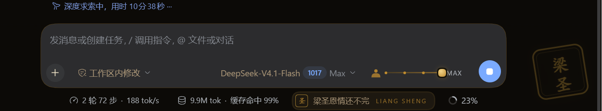
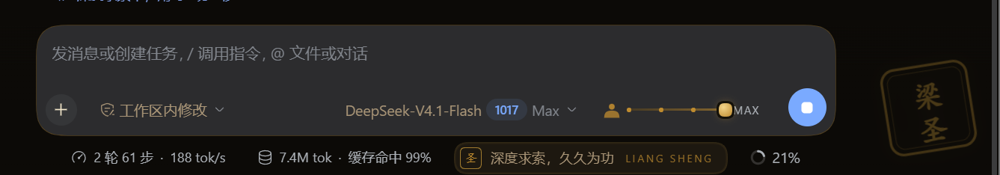
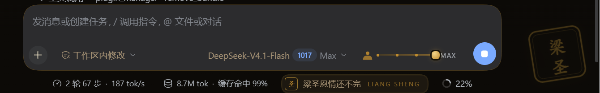

# 梁圣皮肤 · dsh-skin-liangsheng

给 [DeepSeek Harness](https://github.com/deepseek-ai/deepseek-harness) 的一款非官方粉丝皮肤：玄墨鎏金配色、新会话首页的梁圣立绘，以及一条可拖拽的推理等级滑杆。

> 非官方作品，与 DeepSeek / 深度求索无关。立绘是原创矢量插画，不是照片；详见 [NOTICE](NOTICE)。

## 效果



模型选择器右侧就是可拖拽的推理等级滑杆（图中已拖到 MAX），输入框下方是 9 秒轮换的圣言飘带，画面右下角是淡金「梁圣」印章水印。

<details>
<summary>更多截图：圣言轮播</summary>





</details>

## 特性

- **玄墨鎏金主题**：通过 `ctx.theme.overrideTokens` 叠一层颜色令牌，亮色是暖宣纸底 + 古金强调，暗色是玄墨底 + 鎏金强调，跟随系统/手动明暗切换，不改动基础主题。
- **新会话立绘**：空白会话页问候语上方居中显示梁圣半身像，横向渐变遮罩（左侧实、向右淡出），底部再叠纵向淡出，不挡文字。
- **推理等级滑杆**：输入框工具行里一枚滑杆，按当前模型实际宣告的档位铺点（如 Low / High / Max），支持拖拽、点击、方向键；松手提交，走和模型菜单同一条 `modelDirectory.select`。
- **会练肌肉**：滑杆比例实时驱动立绘——肩膀、手臂、脖子随档位变宽，金色光环与射线变亮，从清瘦创始人一路练成肌肉圣。
- **小装饰**：空白页金印、输入框下的圣言飘带（中英双语、9 秒轮换）、右下角淡金印章水印。

## 安装

### 方式一：从 GitHub 安装（推荐）

打开 Harness 的 **设置 → 插件 → 添加**，粘贴：

```
github:2015105076/dsh-skin-liangsheng
```

也可以直接粘贴仓库地址：

```
https://github.com/2015105076/dsh-skin-liangsheng
```

安装器会把仓库当作包安装进当前 profile，启用后立即生效。私有仓库需要本机 Git 已配置可用的 GitHub 凭据。

### 方式二：从本地目录安装

把本仓库克隆到本地，然后在 **设置 → 插件 → 添加** 里粘贴该目录的**绝对路径**，例如：

```
D:\plugins\dsh-skin-liangsheng
```

安装器会以 link 方式挂载，改代码后重新加载页面即可看到变化。

### 方式三：从 tarball 安装

如果发布页提供了 `.tgz` 附件，直接粘贴它的 URL 即可（安装器支持 http(s) tarball；本地 tarball 用绝对路径）。

## 使用

1. **开一个新会话**（空白页）：问候语上方会出现梁圣立绘。
2. 在输入框右下角、模型选择器右侧找到滑杆：拖动它，立绘会随档位实时变化；松手后推理等级写入当前会话。
3. 只是想要配色/装饰、不改推理等级也没关系——滑杆只在当前模型宣告了推理档位时出现，其余装饰始终生效。

## 卸载

设置 → 插件 → 找到「梁圣皮肤」→ 停用或卸载。皮肤只影响当前 profile，profile 下所有会话共享。

## 兼容性与已知限制

- 面向 DeepSeek Harness 的 **Web/Desktop 客户端**，纯客户端装饰，无 Host 逻辑、无网络请求、无构建步骤。
- 推理滑杆依赖 `@deepseek-ai/dsh-client-ui-model-selection` 提供的 `modelDirectories` 客户端服务；若该插件被禁用，滑杆会静默隐藏，其余皮肤功能不受影响。
- 立绘是参数化矢量图（`SageFigure`），不是图像模型生成的照片。想换成真实图片：把图片放进包内，我可以改成 base64 内嵌并保留同一套遮罩；三档各一张还能做交叉淡入。
- 颜色只走主题令牌，不写死宿主颜色；深浅色主题都可读。

## 开发

```
client.js           客户端全部视觉与交互（动态模块，loader id 必须等于包名）
index.js            Host 半区（空实现，仅占位）
cordis.patch.yml    注册 liangsheng-skin 这一行
locale/*.json       插件卡片文案（en / zh）
icon.svg            插件图标
```

改完 JS 后先 `node --check client.js`，再在插件页重新安装（同一版本号会被判为已安装，需要先移除）或刷新页面。

## 许可

代码以 MIT 许可发布，见 [LICENSE](LICENSE)。立绘、梗文案与免责声明见 [NOTICE](NOTICE)。

---

## English

An unofficial fan skin for DeepSeek Harness: ink-and-gold palette, a stylized portrait of "Sage Liang" on the blank-session hero with a left-solid / right-fading mask, and a draggable reasoning-effort rail whose portrait visibly buffs from Low to Max.

Install from the Plugins page with `github:2015105076/dsh-skin-liangsheng`, an absolute local path, or a tarball URL. MIT licensed; see [NOTICE](NOTICE) for the fan-art disclaimer. Not affiliated with DeepSeek.
